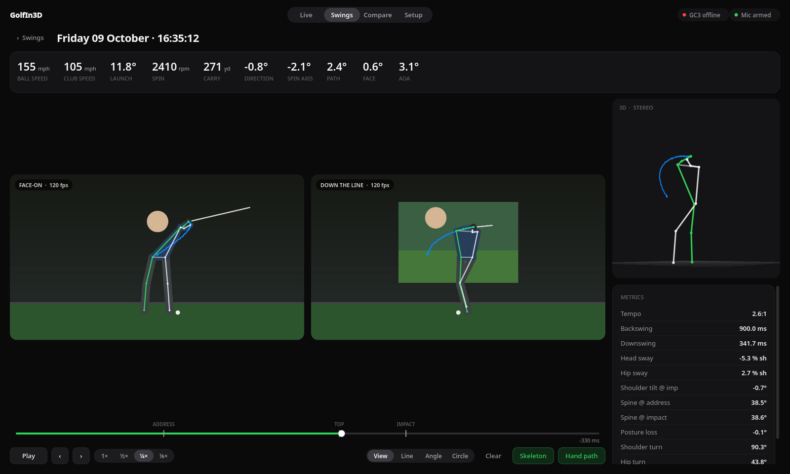

# GolfIn3D

**[Website and downloads](https://kaorii-ako.github.io/GolfIn3D/)** · [Latest release](https://github.com/kaorii-ako/GolfIn3D/releases/latest)



Two-camera golf swing capture for a launch-monitor studio. Every shot is captured automatically from both cameras, with 2D pose on each video, a stereo-triangulated 3D skeleton you can orbit, swing metrics, and the GC3's ball and club numbers on the same screen. Runs on Windows, macOS and Linux.

## Run from source

```bash
uv sync --python 3.12
uv run python -m golfin3d
```

On first launch it downloads the MediaPipe pose models (~30 MB) into `~/GolfIn3D/models`. Swings are saved in `~/GolfIn3D/swings/<timestamp>/`. Each swing folder has `face.avi`, `dtl.avi`, `meta.json` and `pose.npz`.

## Studio setup

1. **Setup → Cameras.** Assign *Face-on* and *Down the line*, then press **Apply**. The real fps shows on each Live tile. For sharp slow-mo at impact, use 120 fps or faster with bright lighting.
2. **Setup → Foresight GC3.** In FSX Play, turn on the **GSPro connection** and point it at this PC. GolfIn3D listens with the GSPro OpenConnect protocol on port 921. Don't run GSPro on the same port at the same time. The pill in the top right turns green when FSX connects.
3. **Setup → Impact microphone.** Put a mic near the mat. Drag the white mark so room noise stays below it and a strike goes above it. The mic gives the exact moment of impact, and the GC3 adds its numbers a moment later. If the mic misses a shot, the GC3 shot still triggers a capture, using **Shot data delay** to estimate the impact time.
4. **Setup → 3D calibration** (once, and again whenever a camera moves). Print a checkerboard, enter its inner-corner count and square size, press **Start calibration**, and move the board slowly through the hitting area so both cameras see it. Until you calibrate, 3D comes from the face-on camera alone and is less accurate.

## Using it

| Where | What |
| --- | --- |
| Live | Both feeds with a live skeleton. Every strike saves 2 s before and 1 s after impact (adjustable). **C** captures manually. |
| Swings | Library. Double-click a swing to open it. Ctrl/⌘-click two swings, then **Compare**. |
| Swing | Synced playback with **Space**, frame step with **← →**, speeds from 1× to ⅛×, line/angle/circle drawing tools, skeleton and hand-path overlays, an orbitable 3D view (drag to spin, scroll to zoom), and metrics. |
| Compare | Two swings side by side, synced at impact, top or address. You can ghost B over A, and both 3D skeletons are overlaid. Shows metric deltas. |

Metrics: tempo (backswing:downswing), head and hip sway, shoulder tilt, spine angle and posture loss (down-the-line), and shoulder turn, hip turn and X-factor (3D).

## Install

Download from the [website](https://kaorii-ako.github.io/GolfIn3D/) or [Releases](https://github.com/kaorii-ako/GolfIn3D/releases/latest):

| OS | File |
| --- | --- |
| Windows 10/11 x64 | `GolfIn3D-Setup-Windows-x64.exe` (installer) |
| macOS 13+ Apple silicon | `GolfIn3D-macOS-arm64.dmg` |
| Linux x86_64 | `GolfIn3D-Linux-x86_64.AppImage` |

The builds are unsigned, so expect a SmartScreen or Gatekeeper prompt on first launch.

## Release a new version

Bump `version` in `pyproject.toml`, then `git tag vX.Y.Z && git push --tags`. `.github/workflows/release.yml` builds and self-tests the three installers, then publishes them as a GitHub Release. The website (`site/`) deploys to GitHub Pages via `.github/workflows/pages.yml`.

To build locally: put the two pose model files in `golfin3d/models/`, then run `uv sync --group dev && uv run pyinstaller GolfIn3D.spec`. After that, run `packaging/appimage.sh` (Linux), `packaging/dmg.sh` (macOS) or `iscc packaging\windows.iss` (Windows).

## Known limits

- Port 921 is privileged on macOS and Linux. Run with admin rights, or change the port on both sides. FSX Play itself is Windows-only, so the usual setup is everything on the studio Windows PC.
- Cameras are timestamped when each frame arrives. That's fine for plain USB webcams. For sub-millisecond sync you'd need hardware-triggered cameras.
- Pose runs on the CPU. Analysing a 3-second, two-camera, 120 fps swing takes about 10 to 20 s, and the swing card shows *Analyzing…* until it's done.
